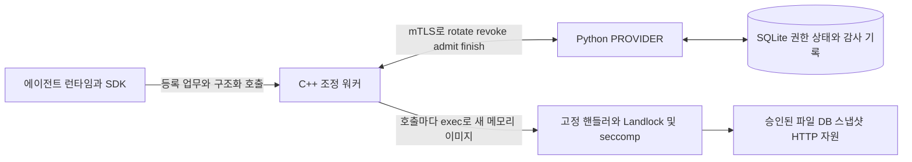

# SAGA Capability 실행 권한 아키텍처

졸업프로젝트 기술 설명서 · 작성 2026년 10월 17일 · 수정 2026년 10월 19일

**인증된 에이전트의 권한을 업무 전체에 누적하지 않고, 매 도구 호출에 필요한 기능·자원·인자만 단일 사용 토큰으로 허용한다. PROVIDER가 권한 교체와 실행 진입을 직렬화하고, C++ 워커가 승인 명세를 커널 제한으로 연결한다.**

## 1 연구 목표와 SAGA와의 관계

해결 대상은 동일 에이전트가 이전 업무의 권한을 다음 업무에서도 사용할 수 있는 문제다. SAGA의 PROVIDER와 사용자 정책에 의한 통신 관리 개념[1]을 참고하여, **기능별 실행 승인·즉시 회수·운영체제 강제**를 결합한 독립 프로토콜을 구현했다. 기존 SAGA의 일회성 키 교환이나 통신 토큰과 직접 호환되는 구현은 아니다.

업무는 신뢰하는 런타임이 지정하는 등록된 `task_id`로 식별한다. 관리자가 에이전트별 업무와 업무별 도구·자원을 사전 등록하면, 이후 토큰 요청과 실행은 자동으로 진행된다. 자연어에서 업무나 신원을 추론해 권한을 만들지 않으며, 사용자의 실제 의도와 호출의 의미적 일치까지 판정하지는 않는다.

## 2 구성 요소와 권한 명세



**PROVIDER**는 인증·호출 정규화·정책 검사와 권한 상태를 소유한다. **조정 워커**는 인증정보와 통신을 관리하고 토큰을 검증한다. **실행 프로세스**는 승인된 고정 C++ 핸들러 하나만 수행한다. SQLite에는 에이전트 세대, 토큰 상태, 실행 ID, 감사 순서를 보존한다.

신원은 실제 mTLS 클라이언트 인증서의 SHA-256 지문과 등록된 에이전트 ID의 대응으로 결정한다. 모델의 이름·설명이나 HTTP 신원 헤더는 인증 근거가 아니다. PROVIDER 소유 어댑터는 canonical·OpenAI·Anthropic·Gemini·MCP의 **단일 호출 양식**을 동일 구조로 변환한다. 양식 변환은 권한 확대나 벤더 SDK 전체 지원을 의미하지 않는다.

Ed25519 서명 토큰은 다음을 함께 고정한다.

| 묶음 | 토큰에 결합되는 정보 |
| --- | --- |
| 주체와 수명 | 에이전트 ID, 원래 인증서 지문, 업무 ID, 세대 `epoch`, 토큰 ID `jti`, 발급·만료 시각, 버전·발급자·수신자 |
| 실행 범위 | 도구, 자원, 동작, 정확한 인자, 등록된 경로·SQL·URL 등 실행 명세, 허용 파일 권한·TCP 포트 |

세대는 **에이전트 전체에 공통**이며 업무별로 분리하지 않는다. 같은 자원을 다시 호출해도 새 토큰을 받는다. 따라서 이전 기능·자원 권한을 합친 토큰을 재사용하지 않는다.

논리적 작업에는 별도의 영속 `operation_id`를 부여한다. 같은 ID의 재시도는 원래 인증서·업무·정규화 호출과 결합된 기존 작업을 조회하며 새 토큰을 발행하지 않는다. 아직 승인 전이면 원래 grant를 반환하고, 실행 중이면 상태만, 완료 뒤에는 저장된 영수증을 반환한다. 만료·회수된 ID도 다시 살아나지 않는다. 위의 새 토큰 발행은 **새 논리적 작업**에 해당한다.

SDK의 `WorkerClient.request_resource(task_id=..., tool=..., resource=..., **arguments)`가 매 호출마다 필요한 자원 하나를 요청한다. 워커가 직접 PROVIDER와 통신하며 SDK는 권한을 캐시하지 않는다. 등록되지 않은 자원은 자동으로 허용하지 않는다.

## 3 회수와 발행의 원자적 교체

호출은 `state → rotate → 서명 검증 → admit → 실행 → finish` 순서로 진행된다. `rotate(expected_epoch)`는 정책 검사를 통과한 뒤 다음 변경을 하나의 `BEGIN IMMEDIATE` 트랜잭션으로 처리한다.

1. 요청 세대가 현재 세대와 같은지, 미완료 실행이 없는지 확인한다.
2. 기존 grant를 `REVOKED`로 바꾸고, 다음 세대의 새 grant를 `ACTIVE`로 기록한다.
3. 세대·현재 토큰·감사 기록을 함께 커밋한 뒤 새 토큰을 응답한다.

**회수의 효력 경계는 커밋이다.** 새 토큰이 공개된 시점에는 기존 토큰으로 실행을 시작할 수 없다. 실제 서명 생성은 같은 트랜잭션 안에서 회수 갱신보다 먼저 수행되지만, 커밋 전에는 새 토큰을 외부에 공개하지 않는다. 커밋 전 처리 오류는 전체 변경을 롤백하여 기존 상태를 보존한다. 별도의 회수 커밋과 발행 커밋 사이에 공백을 두는 설계는 아니다.

이전 토큰의 admission이 먼저 성공하면 교체가 거절되고, 교체가 먼저 커밋되면 이전 토큰의 admission이 거절된다. 예상 세대 비교와 DB 제약이 경쟁 요청의 중복 성공을 막는다.

새 권한 없이 위임만 회수하려면 `POST /v1/revoke {expected_epoch}` 또는 SDK `revoke()`를 호출한다. 현재 grant 회수·세대 증가·현재 토큰 제거를 한 트랜잭션으로 처리한다. **서명의 수학적 유효성은 지울 수 없지만, 회수한 토큰의 실행 권한은 온라인 admission에서 차단한다.** 실행 중이면 `execution_busy`로 회수를 거절하며 취소했다고 보고하지 않는다.

## 4 단일 사용 승인과 실행 경계

```text
ACTIVE(g) ── admit ──▶ EXECUTING(g) ── finish ──▶ FINISHED(g)
ACTIVE(g) 또는 FINISHED(g) ── rotate ──▶ REVOKED(g) + ACTIVE(g+1)
```

워커는 고정된 PROVIDER 공개키로 서명 원문과 주체·업무·세대·수명을 검증한다. 이어 `admit(token)`가 원래 인증서, 실제 발행 토큰, 현재 세대·상태·만료를 검사하고, **현재 정책으로 다시 구성한 실행 명세가 서명된 명세와 같은지** 확인한다. 승인된 토큰은 같은 트랜잭션에서 `EXECUTING`으로 소비된다. 워커는 admission 응답도 서명된 명세와 일치해야 실행한다.

항상 유지하는 조건은 **① 에이전트당 ACTIVE 또는 EXECUTING grant 최대 하나, ② 미완료 실행 최대 하나, ③ 토큰당 admission 성공 최대 한 번, ④ EXECUTING 동안 교체 금지**다. DB의 부분 고유 인덱스와 트랜잭션이 이를 뒷받침한다.

조정 워커는 자식의 종료를 확인한 뒤 원래 인증서와 `execution_id`로 `finish`한다. 동일 결과의 완료 재전송은 멱등적이다. 실행 경계에서만 권한을 교체하므로 워커의 임의 회수나 이전 작업 취소·효과 롤백이 필요하지 않다.

## 5 승인 명세를 실제 접근 제한으로 연결

| 계층 | 실제 책임 |
| --- | --- |
| 정책과 고정 핸들러 | 도구·자원·인자와 실행 경로·등록 SQL·HTTP 목적지를 제한한다. 서명된 sandbox가 핸들러에서 도출한 최소 요구와 정확히 같아야 한다. |
| Landlock ABI 9 이상 | 승인 파일의 읽기 또는 쓰기·절단, TCP 연결 포트, pathname·abstract UNIX 소켓과 신호 범위를 제한한다.[2] |
| seccomp와 프로세스 관리 | exec·fork·ptrace·UDP 생성 등 우회 수단을 제한하고, 상속 FD·환경 정리, 자원 한도, 부모 사망 시 종료와 자식 회수를 적용한다. |

Landlock 제한은 완화할 수 없으므로 호출마다 새 실행 프로세스를 만든다. 필수 ABI가 없으면 실행을 거절한다. **TCP 포트 허용은 특정 IP나 GET만 허용한다는 뜻이 아니므로**, 함수 의미와 목적지는 정책·핸들러가 별도로 강제한다.

현재 구조는 이미 coordinator가 호출마다 새 executor를 만드는 cycling이다. 이것만으로 동일 agent의 논리적 잠금이 사라지지는 않는다. 별도로 등록된 agent끼리의 병렬 실행은 실제 HTTP 처리 구간의 겹침으로 확인했다. fork·exec·sandbox·전체 mTLS 호출을 구분한 가설과 실측, lane/pool 도입의 의미 변화는 [트레이드오프 분석](concurrency-tradeoffs.ko.md)에 기록했다.

## 6 장애 정책과 보장 범위

만료는 새 admission만 차단하며 실행을 취소하지 않는다. admission 이후 **finish가 기록되지 않은 잠금**은 워커 단절·만료·PROVIDER 재시작으로 자동 해제되지 않는다. 이는 권한 중첩 방지를 위해 자동 복구 가용성을 포기한 선택이다. 완료 응답 유실 시 기록과 효과가 불확실하므로 자동 재실행하지 않는다. **토큰당 승인 횟수 제한은 실행 성공·외부 효과의 exactly-once·쓰기 롤백을 보장하지 않는다.**

PROVIDER·등록 정책·키·런타임/조정 워커·고정 핸들러·커널을 신뢰하며, 보호 대상은 이 경로를 통과하는 도구 호출이다. 같은 OS 사용자 권한의 적대적 프로그램이나 인증정보 탈취는 경계 밖이다. 실행 자식은 라이브러리에 포함된 봉인 ELF를 `execveat`하여 부모 메모리 매핑을 교체한 뒤에만 핸들러를 실행한다. 현재 capability만 봉인된 비실행 memfd로 전달하고, 이전 호출 결과·토큰·TLS 인증정보는 전달하지 않는다. 실행 memfd를 금지한 호스트에서는 실행을 거절하며 fork만 하는 우회는 없다. 이는 물리 RAM 소거 또는 모델이 이미 받은 정보의 삭제를 뜻하지 않는다. C++ 임베딩은 단일 스레드와 기본 SIGCHLD 설정을 전제로 한다.

실패는 `call_id`·요청 ID·처리 단계·고정 오류 코드로 연결한다. PROVIDER의 실패 기록은 거절된 트랜잭션의 롤백 후 별도로 영속화하며, 완료 감사 기록에는 outcome과 안전한 failure_code를 남긴다. `/v1/audit`와 `/v1/failures`는 인증된 본인의 기록만 페이지 단위로 제공한다. SDK의 `failure_log`는 PROVIDER 접속 실패·타임아웃도 0600 JSONL에 동기 기록한다. 토큰·본문·SQL·파일 내용·원문 예외는 기록하지 않는다. 저장장치 장애는 숨기지 않고 고정 필드의 stderr 기록과 오류로 알린다.

상태 조회, 명확한 세대 충돌, 같은 실행 ID의 멱등 완료만 제한적으로 재시도한다. 발급·admission 응답 유실은 자동 재전송하지 않는다. 영수증의 `admission_uncertain`·`completion_recorded`·`retry_safe`로 불확실성을 구분하며, 배치의 뒤 응답이 끊겨도 이미 받은 영수증과 실패 기록은 보존한다.

타임아웃 뒤 호출자는 **같은 operation ID**로 상태·결과를 회복한다. SDK는 프로세스 시작 전에 ID를 만들고 영수증이 없어도 `WorkerError.operation_ids`에 보존한다. finish 트랜잭션은 결과 영수증과 완료를 함께 커밋하므로 완료 응답만 유실되면 결과를 회복할 수 있다. 효과가 발생한 뒤 finish 자체가 커밋되지 않으면 상태는 불명확한 실행 중으로 남는다. 이 경우 자동 재실행하거나 잠금을 풀지 않는다. 저장된 영수증에는 실제 출력이 들어가므로 비밀을 제외한 감사 로그와 구분해 보호한다.

현재 핸들러는 **기존 일반 파일 읽기·쓰기, 불변 SQLite 스냅샷의 등록 SELECT와 바인딩 인자, 등록된 숫자 loopback HTTP GET**이다. 상태 저장은 단일 호스트 SQLite WAL/FULL 동기화가 경계다. 공유 DB의 PROVIDER는 같은 정책·등록·키를 사용하고 정책 변경 시 기존 인스턴스를 종료해야 한다. 독립 DB 간 합의·자동 장애 복구·실제 벤더 모델 호출은 구현 범위에 포함하지 않는다.

## 7 검증 근거

현재 추가 요구사항 통합본은 일반 Release와 Clang UBSan에서 각각 **Python 545개·CTest 2개**를 제외 없이 통과했다. 동일 요청 ID의 동시 ready/admit 경쟁, 늦은 완료와 실제 타임아웃·응답 유실, 추가 커밋 전후 crash, 3 MiB 초과 결과 보존, 벤더 호출 ID 왕복, null/NUL 경로와 직접 C++ 설정을 포함한다. 동시 재시도의 잘못된 retry_safe 표시와 계층 간 ID 문법 차이도 독립 재현 후 수정했다. 아래 151개·92개 수치는 이전 단계의 근거다.

추가 장애 검증에서는 기존 92개 테스트가 놓친 TLS 수락 루프 정지, 느린 헤더·본문, 거절 로그의 DB 잠금, 잘린 HTTP 응답의 성공 처리, SDK 영수증 유실·로그 잠금 대기, 낮은 파일 크기 제한의 호스트 종료를 재현해 수정했다. 최종 일반·UBSan 빌드 각각 Python **151개·CTest 2개**가 통과했다. 실제 PROVIDER를 커밋 직전/직후 종료하는 8개 검증과 독립 재현 검토를 추가했으며, 최종 HTTP 파서의 ASan/UBSan fuzz 818,234회에서 메모리 오류는 발견되지 않았다. 이는 무결함 증명이 아니며 정확한 범위와 남는 한계는 [상세 기록](verification.md)에 적었다. 아래 92개 기록은 추가 장애 검증 전의 결과다.

**2026년 10월 19일 초기 보완 코드**는 외부 Chinook/mTLS 실험을 포함한 Python **92개를 제외 없이 통과**했고 CTest **2개**도 통과했다. 별도 Clang UBSan 빌드에서도 같은 92개·2개 검증이 통과했다. 회수 후 서명 유효/admission 거절, 회수 경쟁·재시작, 부모 메모리 매핑 제거·환경/FD 정리, 실행 도중 강제 종료·정지 후 회수, 응답 유실과 배치 부분 결과 보존, 실패 로그 영속성·비밀 제외를 검증했다. 정적·공유 라이브러리 모두 설치 후 원래 private SQLite 경로를 제거해도 새 실행 도우미가 동작함을 확인했다. 아래 10월 13일 기록과 원격 소스 링크는 초기 버전의 역사적 근거다.

**2026년 10월 13일 실행 기록 기준**, Python 48개와 CTest 2개가 통과했고 UBSan에서도 동일 검증이 통과했다. 실제 ABI 9에서 파일·TCP·UNIX 소켓·신호·위험 syscall 제한, mTLS, 토큰 재사용·교체 경쟁·재시작·정책 및 인증서 변경을 검사했다. 외부 Chinook DB와 5종 양식의 통합 실험은 9건 중 8건 실행·1건 거부했으며, 거부 시 실행 프로세스를 만들지 않았다. 설치된 CMake 라이브러리와 Python wheel 사용도 검증했다.[3][4]

이 근거는 구현 동작과 불변조건에 대한 테스트 결과다. 정형 증명이나 SAGA 대비 성능 우위를 의미하지 않는다.

## 참고 근거

[1] Syros 외, [SAGA, NDSS 2026](https://www.ndss-symposium.org/wp-content/uploads/2026-s869-paper.pdf).

[2] Linux Kernel, [Landlock userspace API](https://docs.kernel.org/userspace-api/landlock.html).

[3] [구현 소스 55c18ca](https://github.com/studyreadbook4ever/GraduateProject/tree/55c18ca9ee00dca6f03817c3784bf5e5ba371055): `saga/provider/core.py`, `worker/src/worker.cpp`, `worker/src/sandbox.cpp`.

[4] [상세 검증 기록](verification.md), `.artifacts/pytest-verification.xml`, `.artifacts/pytest-ubsan.xml`, `.artifacts/e2e-receipt.json`.
